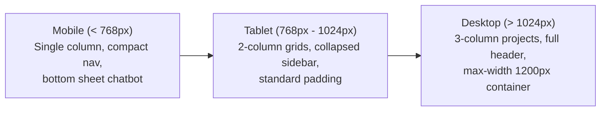

# Design System & Visual Guidelines

**Project:** Personal Developer Portfolio Website  
**Course:** SE 236 — Desktop & Web Programming Lab  
**Document Version:** 1.0.0  
**Status:** Approved Specification  

---

## Table of Contents
1. [Design Philosophy](#1-design-philosophy)
2. [Color Palette & Theming](#2-color-palette--theming)
   - [Light Theme](#light-theme)
   - [Dark Theme](#dark-theme)
   - [Gradient Combinations](#gradient-combinations)
   - [CSS Custom Properties (Variables)](#css-custom-properties)
3. [Typography System](#3-typography-system)
   - [Font Families & Web Fonts](#font-families)
   - [Type Scale Hierarchy](#type-scale)
   - [Typographic Best Practices](#typographic-best-practices)
4. [Spacing & Layout Rhythm](#4-spacing-system)
5. [Border Radius & Elevation](#5-border-radius)
6. [Shadow System & Elevation Hierarchy](#6-shadows)
7. [Component Design Specifications](#7-component-styles)
   - [Buttons](#buttons)
   - [Cards](#cards)
   - [Form Inputs & Validation States](#form-inputs)
   - [Navigation Bar](#navigation-bar)
   - [Interactive Chatbot Widget](#chatbot-styles)
   - [Skill Badges & Tags](#skill-badges)
8. [Animation & Motion Guidelines](#8-animation-guidelines)
   - [Transitions & Easings](#transitions--easings)
   - [Keyframe Animations](#keyframe-animations)
   - [Accessibility & Reduced Motion](#reduced-motion)
9. [Responsive Breakpoints & Grid System](#9-responsive-breakpoints)
10. [Iconography System](#10-icon-system)
11. [Image & Media Guidelines](#11-image-guidelines)

---

## 1. Design Philosophy

The portfolio follows an intentional design ethos balancing academic rigor with cutting-edge web design industry standards:

- **Clean, Modern, and Professional Aesthetic:** Built around clarity, visual whitespace, and crisp visual hierarchy without overwhelming or sensory fatigue.
- **Minimalist with Purposeful Visual Accents:** Every badge, card border, glow, and gradient serves to anchor user attention to crucial developer achievements, project capabilities, and skills.
- **Consistent Design Language Throughout:** Monolithic CSS variables guarantee cohesive margins, corner rounding, hover states, and color contrasts across both light and dark display modes.
- **Content-First Hierarchy:** Typography, typography weights, and line-height values are tuned for swift scanning by recruiters, peer developers, and evaluators.
- **Purposeful Micro-interactions:** Fluid hover transformations and GPU-accelerated transitions give real-time feedback while respecting device performance and accessibility guidelines (`prefers-reduced-motion`).

---

## 2. Color Palette & Theming

### Light Theme

| Role | Color Name | Hex Code | HSL / RGB | Usage Context |
|------|------------|----------|-----------|---------------|
| **Primary** | Royal Blue | `#2563EB` | `rgb(37, 99, 235)` | Primary CTA buttons, active links, primary icons, highlights |
| **Primary Dark** | Dark Blue | `#1D4ED8` | `rgb(29, 78, 216)` | Primary button hover states, active tab markers |
| **Primary Light** | Light Blue | `#DBEAFE` | `rgb(219, 234, 254)` | Soft pill badge backgrounds, active filter backings, focus rings |
| **Secondary** | Emerald Green | `#10B981` | `rgb(16, 185, 129)` | Live project indicators, success alerts, verification badges |
| **Accent** | Electric Purple | `#7C3AED` | `rgb(124, 58, 237)` | Special gradients, featured badges, AI chatbot brand accents |
| **Background** | Pure White | `#FFFFFF` | `rgb(255, 255, 255)` | Main base page canvas, default top-level background |
| **Surface** | Light Gray | `#F8FAFC` | `rgb(248, 250, 252)` | Alternating section containers, standard card backgrounds |
| **Surface Alt** | Muted Gray | `#F1F5F9` | `rgb(241, 245, 249)` | Input fields, code snippets, tertiary surfaces |
| **Text Primary** | Slate Dark Gray | `#1E293B` | `rgb(30, 41, 59)` | Main headings, body copy, active text (High contrast: 12.6:1) |
| **Text Secondary**| Slate Medium Gray | `#64748B` | `rgb(100, 116, 139)` | Subtitles, project descriptions, secondary metadata |
| **Text Muted** | Slate Light Gray | `#94A3B8` | `rgb(148, 163, 184)` | Input placeholders, timestamps, disabled elements |
| **Border** | Slate Border | `#E2E8F0` | `rgb(226, 232, 240)` | Card outlines, dividers, input default boundaries |
| **Error** | Red Coral | `#EF4444` | `rgb(239, 68, 68)` | Form validation errors, destructive prompts |
| **Warning** | Warm Amber | `#F59E0B` | `rgb(245, 158, 11)` | Notice banners, in-progress tags |
| **Success** | Emerald | `#10B981` | `rgb(16, 185, 129)` | Form submission successes, online status badges |

### Dark Theme

| Role | Color Name | Hex Code | HSL / RGB | Usage Context |
|------|------------|----------|-----------|---------------|
| **Primary** | Sky Blue | `#3B82F6` | `rgb(59, 130, 246)` | Dark theme primary buttons, interactive links, brand accents |
| **Primary Dark** | Lighter Azure | `#60A5FA` | `rgb(96, 165, 250)` | Hover state on dark mode primary buttons, bright highlights |
| **Primary Light**| Midnight Blue | `#1E3A5F` | `rgb(30, 58, 95)` | Soft dark badge backgrounds, subtle active state backdrops |
| **Secondary** | Vibrant Mint | `#10B981` | `rgb(16, 185, 129)` | Status indicators, success tags |
| **Accent** | Vivid Violet | `#8B5CF6` | `rgb(139, 92, 246)` | Gradient stops, featured card highlights, chatbot styling |
| **Background** | Deep Charcoal / Slate | `#0F172A` | `rgb(15, 23, 42)` | Root page dark background |
| **Surface** | Dark Slate Surface | `#1E293B` | `rgb(30, 41, 59)` | Dark cards, modals, navigation bar backing |
| **Surface Alt** | Deep Steel | `#334155` | `rgb(51, 65, 85)` | Elevated panels, inputs, secondary badges |
| **Text Primary** | Soft White / Snow | `#F1F5F9` | `rgb(241, 245, 249)` | Headings, primary content (High contrast: 13.8:1) |
| **Text Secondary**| Light Muted Slate | `#94A3B8` | `rgb(148, 163, 184)` | Secondary subtitles, project descriptions |
| **Text Muted** | Slate Gray | `#64748B` | `rgb(100, 116, 139)` | Minor metadata, footer notes, input placeholders |
| **Border** | Dark Border Slate | `#334155` | `rgb(51, 65, 85)` | Dark container outlines, card borders, horizontal rules |

### Gradient Combinations

```css
/* Hero Headline / Accent Glows */
--gradient-hero: linear-gradient(135deg, #2563EB 0%, #7C3AED 100%);

/* Interactive Card Hover Overlay */
--gradient-card-hover: linear-gradient(135deg, #3B82F6 0%, #10B981 100%);

/* Floating Assistant Header & Badge Background */
--gradient-chatbot: linear-gradient(135deg, #2563EB 0%, #7C3AED 100%);

/* Subtle Surface Mesh Gradient (Dark Mode) */
--gradient-dark-glow: radial-gradient(circle at 50% 0%, rgba(37, 99, 235, 0.15) 0%, transparent 70%);
```

### CSS Custom Properties

```css
:root {
  /* Color Palette - Light Theme */
  --primary: #2563EB;
  --primary-dark: #1D4ED8;
  --primary-light: #DBEAFE;
  --primary-rgb: 37, 99, 235;

  --secondary: #10B981;
  --secondary-rgb: 16, 185, 129;
  --accent: #7C3AED;
  --accent-rgb: 124, 58, 237;

  /* Surfaces & Backgrounds */
  --bg-primary: #FFFFFF;
  --bg-secondary: #F8FAFC;
  --bg-tertiary: #F1F5F9;

  /* Text & Hierarchy */
  --text-primary: #1E293B;
  --text-secondary: #64748B;
  --text-muted: #94A3B8;

  /* Structural Borders */
  --border: #E2E8F0;
  --border-focus: #2563EB;

  /* Status Colors */
  --success: #10B981;
  --error: #EF4444;
  --warning: #F59E0B;

  /* Gradients */
  --gradient-hero: linear-gradient(135deg, #2563EB 0%, #7C3AED 100%);
  --gradient-card: linear-gradient(135deg, #3B82F6 0%, #10B981 100%);
  --gradient-chatbot: linear-gradient(135deg, #2563EB 0%, #7C3AED 100%);

  /* Shadows */
  --shadow-sm: 0 1px 2px rgba(0, 0, 0, 0.05);
  --shadow-md: 0 4px 6px -1px rgba(0, 0, 0, 0.07), 0 2px 4px -2px rgba(0, 0, 0, 0.05);
  --shadow-lg: 0 10px 25px -3px rgba(0, 0, 0, 0.1), 0 4px 6px -4px rgba(0, 0, 0, 0.05);
  --shadow-xl: 0 20px 50px -5px rgba(0, 0, 0, 0.12), 0 8px 10px -6px rgba(0, 0, 0, 0.05);
  --shadow-glow: 0 0 20px rgba(37, 99, 235, 0.35);

  /* Spacing Scale */
  --space-xs: 0.25rem;    /* 4px */
  --space-sm: 0.5rem;     /* 8px */
  --space-md: 1rem;       /* 16px */
  --space-lg: 1.5rem;     /* 24px */
  --space-xl: 2rem;       /* 32px */
  --space-2xl: 3rem;      /* 48px */
  --space-3xl: 4rem;      /* 64px */
  --space-4xl: 6rem;      /* 96px */

  /* Border Radii */
  --radius-sm: 0.375rem;  /* 6px */
  --radius-md: 0.5rem;    /* 8px */
  --radius-lg: 0.75rem;   /* 12px */
  --radius-xl: 1rem;      /* 16px */
  --radius-full: 9999px;

  /* Typography Stacks */
  --font-sans: 'Inter', system-ui, -apple-system, BlinkMacSystemFont, 'Segoe UI', Roboto, sans-serif;
  --font-mono: 'JetBrains Mono', 'Fira Code', ui-monospace, SFMono-Regular, monospace;

  /* Motion & Durations */
  --transition-fast: 150ms cubic-bezier(0.4, 0, 0.2, 1);
  --transition-normal: 300ms cubic-bezier(0.4, 0, 0.2, 1);
  --transition-slow: 600ms cubic-bezier(0.16, 1, 0.3, 1);
}

[data-theme='dark'] {
  /* Color Palette - Dark Theme */
  --primary: #3B82F6;
  --primary-dark: #60A5FA;
  --primary-light: #1E3A5F;
  --primary-rgb: 59, 130, 246;

  --secondary: #10B981;
  --secondary-rgb: 16, 185, 129;
  --accent: #8B5CF6;
  --accent-rgb: 139, 92, 246;

  /* Surfaces & Backgrounds */
  --bg-primary: #0F172A;
  --bg-secondary: #1E293B;
  --bg-tertiary: #334155;

  /* Text & Hierarchy */
  --text-primary: #F1F5F9;
  --text-secondary: #94A3B8;
  --text-muted: #64748B;

  /* Structural Borders */
  --border: #334155;
  --border-focus: #3B82F6;

  /* Shadows */
  --shadow-sm: 0 1px 2px rgba(0, 0, 0, 0.2);
  --shadow-md: 0 4px 6px rgba(0, 0, 0, 0.3);
  --shadow-lg: 0 10px 25px rgba(0, 0, 0, 0.4);
  --shadow-xl: 0 20px 50px rgba(0, 0, 0, 0.5);
  --shadow-glow: 0 0 25px rgba(59, 130, 246, 0.45);
}
```

---

## 3. Typography

### Font Families
- **Headings & Body Copy:** `'Inter', sans-serif`  
  A modern, geometric sans-serif engineered specifically for screen legibility, clean letter spacing, and versatile weights (Light 300 to ExtraBold 800).
- **Code, Terminals & Technical Identifiers:** `'JetBrains Mono', 'Fira Code', monospace`  
  Designed for developers with distinct character distinctions (`0` vs `O`, `1` vs `l`) and clear tabular spacing.
- **System Fallback Stack:** `system-ui, -apple-system, BlinkMacSystemFont, 'Segoe UI', Roboto, Helvetica, Arial, sans-serif`

### Google Fonts Import
Place this directly inside the `<head>` of HTML or at the very top of `styles.css`:

```html
<link rel="preconnect" href="https://fonts.googleapis.com">
<link rel="preconnect" href="https://fonts.gstatic.com" crossorigin>
<link href="https://fonts.googleapis.com/css2?family=Inter:wght@300;400;500;600;700;800&family=JetBrains+Mono:wght@400;500&display=swap" rel="stylesheet">
```

Or via CSS:
```css
@import url('https://fonts.googleapis.com/css2?family=Inter:wght@300;400;500;600;700;800&family=JetBrains+Mono:wght@400;500&display=swap');
```

### Type Scale

| Typography Token | Desktop Size | Mobile Size (< 768px) | Font Weight | Line Height | Letter Spacing |
|---|---|---|---|---|---|
| **Display / H1 (Hero)** | `3.5rem` (56px) | `2.25rem` (36px) | 800 (Extra Bold) | `1.1` | `-0.025em` |
| **H2 (Section Header)** | `2.5rem` (40px) | `1.75rem` (28px) | 700 (Bold) | `1.2` | `-0.02em` |
| **H3 (Card Header)** | `1.5rem` (24px) | `1.25rem` (20px) | 600 (Semi Bold) | `1.3` | `-0.015em` |
| **H4 (Subheadings)** | `1.25rem` (20px) | `1.125rem` (18px) | 600 (Semi Bold) | `1.4` | `-0.01em` |
| **Body Large (Lead)** | `1.125rem` (18px)| `1.0rem` (16px) | 400 (Regular) | `1.7` | `normal` |
| **Body (Default)** | `1.0rem` (16px) | `0.9375rem` (15px) | 400 (Regular) | `1.6` | `normal` |
| **Body Small** | `0.875rem` (14px)| `0.8125rem` (13px)| 400 (Regular) | `1.5` | `normal` |
| **Caption / Meta** | `0.75rem` (12px) | `0.75rem` (12px) | 500 (Medium) | `1.4` | `+0.02em` |
| **Button Label** | `1.0rem` (16px) | `0.875rem` (14px) | 600 (Semi Bold) | `1.0` | `+0.01em` |
| **Code Inline / Snippet** | `0.875rem` (14px)| `0.8125rem` (13px)| 500 (Medium) | `1.5` | `normal` |

### Typographic Best Practices
- Never use more than 3 distinct font sizes within a single card component.
- Keep maximum reading measure (`max-width: 65ch` to `75ch`) on long descriptive paragraphs to protect eye-tracking comfort.
- Utilize gradient text mask selectively for hero highlights:
  ```css
  .text-gradient {
    background: var(--gradient-hero);
    -webkit-background-clip: text;
    -webkit-text-fill-color: transparent;
  }
  ```

---

## 4. Spacing System

A consistent 8-point base grid is employed to generate vertical and horizontal balance across all viewports.

| Spacing Token | CSS Value | Pixel Equivalent | Typical Implementation |
|---|---|---|---|
| `--space-xs` | `0.25rem` | 4px | Icon-to-label gaps, tight badge margins |
| `--space-sm` | `0.5rem` | 8px | Button inner padding (vertical), tag padding |
| `--space-md` | `1.0rem` | 16px | Form input gaps, card internal sub-grouping |
| `--space-lg` | `1.5rem` | 24px | Card inner padding, list item separations |
| `--space-xl` | `2.0rem` | 32px | Grid gutters, modular component spacing |
| `--space-2xl` | `3.0rem` | 48px | Inter-block separators, tablet section margins |
| `--space-3xl` | `4.0rem` | 64px | Standard section vertical padding (`padding: 4rem 0`) |
| `--space-4xl` | `6.0rem` | 96px | Hero banner top/bottom margin, large section divides |

---

## 5. Border Radius

| Radius Token | CSS Value | Pixel Equiv | Component Usage |
|---|---|---|---|
| `--radius-sm` | `0.375rem` | 6px | Code chips, tooltips, tags, small status dots |
| `--radius-md` | `0.5rem` | 8px | Standard CTA buttons, text fields, dropdown menus |
| `--radius-lg` | `0.75rem` | 12px | Standard project cards, testimonial blocks |
| `--radius-xl` | `1.0rem` | 16px | Modals, Chatbot container, floating sheets |
| `--radius-full` | `9999px` | Fully Rounded | Avatar circles, pill filter chips, floating launch button |

---

## 6. Shadows & Elevation Hierarchy

Elevation creates physical depth, distinguishing static content from interactive and floating layers.

```css
/* Level 0: Flat elements, bordered inputs */
box-shadow: none;

/* Level 1: Subtle separation (Default Card state) */
--shadow-sm: 0 1px 2px rgba(0, 0, 0, 0.05);

/* Level 2: Interactive elements (Card Rest State) */
--shadow-md: 0 4px 6px -1px rgba(0, 0, 0, 0.07), 0 2px 4px -2px rgba(0, 0, 0, 0.05);

/* Level 3: Card Hover & Sticky Navbar */
--shadow-lg: 0 10px 25px -3px rgba(0, 0, 0, 0.1), 0 4px 6px -4px rgba(0, 0, 0, 0.05);

/* Level 4: Floating Chatbot Panel & Modal Dialogs */
--shadow-xl: 0 20px 50px -5px rgba(0, 0, 0, 0.12), 0 8px 10px -6px rgba(0, 0, 0, 0.05);

/* Dynamic Colored Glow: Used for Primary Accent items */
--shadow-primary-glow: 0 8px 24px rgba(37, 99, 235, 0.3);
```

---

## 7. Component Styles

### Buttons

Buttons feature high tactile responsiveness with smooth micro-interactions.

```css
/* Base Button Structure */
.btn {
  display: inline-flex;
  align-items: center;
  justify-content: center;
  gap: var(--space-sm);
  font-family: var(--font-sans);
  font-size: 1rem;
  font-weight: 600;
  padding: 0.75rem 1.5rem;
  border-radius: var(--radius-md);
  border: 1px solid transparent;
  cursor: pointer;
  text-decoration: none;
  transition: transform var(--transition-fast), 
              box-shadow var(--transition-fast), 
              background-color var(--transition-fast), 
              color var(--transition-fast);
  user-select: none;
  white-space: nowrap;
}

.btn:active {
  transform: scale(0.98);
}

/* Primary Button */
.btn-primary {
  background-color: var(--primary);
  color: #FFFFFF;
  box-shadow: var(--shadow-sm);
}

.btn-primary:hover {
  background-color: var(--primary-dark);
  box-shadow: var(--shadow-lg), var(--shadow-primary-glow);
  transform: translateY(-2px);
}

/* Secondary Button (Outline) */
.btn-secondary {
  background-color: transparent;
  border-color: var(--primary);
  color: var(--primary);
}

.btn-secondary:hover {
  background-color: var(--primary-light);
  transform: translateY(-2px);
}

[data-theme='dark'] .btn-secondary:hover {
  background-color: rgba(59, 130, 246, 0.15);
}

/* Ghost Button */
.btn-ghost {
  background-color: transparent;
  color: var(--text-secondary);
}

.btn-ghost:hover {
  background-color: var(--bg-tertiary);
  color: var(--text-primary);
}

/* Circular Icon Button */
.btn-icon {
  width: 44px;
  height: 44px;
  padding: 0;
  border-radius: var(--radius-full);
  display: inline-flex;
  align-items: center;
  justify-content: center;
}
```

### Cards

Cards form the foundation for Projects, Skills, and Timeline experiences.

```css
.card {
  background-color: var(--bg-primary);
  border: 1px solid var(--border);
  border-radius: var(--radius-lg);
  padding: var(--space-lg);
  box-shadow: var(--shadow-sm);
  transition: transform var(--transition-normal), 
              box-shadow var(--transition-normal), 
              border-color var(--transition-normal);
  position: relative;
  overflow: hidden;
}

.card:hover {
  transform: translateY(-6px);
  box-shadow: var(--shadow-xl);
  border-color: rgba(37, 99, 235, 0.4);
}

/* Featured / Accent Border Highlight */
.card-featured::before {
  content: '';
  position: absolute;
  top: 0;
  left: 0;
  width: 100%;
  height: 4px;
  background: var(--gradient-hero);
}
```

### Form Inputs

Input controls are tuned for high accessibility, distinct focus indicators, and inline validation states.

```css
.form-group {
  margin-bottom: var(--space-md);
  display: flex;
  flex-direction: column;
  gap: var(--space-xs);
}

.form-label {
  font-size: 0.875rem;
  font-weight: 500;
  color: var(--text-primary);
}

.form-input,
.form-textarea {
  width: 100%;
  padding: 0.75rem 1rem;
  font-family: var(--font-sans);
  font-size: 1rem;
  color: var(--text-primary);
  background-color: var(--bg-primary);
  border: 1.5px solid var(--border);
  border-radius: var(--radius-md);
  outline: none;
  transition: border-color var(--transition-fast), box-shadow var(--transition-fast);
}

.form-input::placeholder,
.form-textarea::placeholder {
  color: var(--text-muted);
}

.form-input:focus,
.form-textarea:focus {
  border-color: var(--primary);
  box-shadow: 0 0 0 3px rgba(37, 99, 235, 0.2);
}

/* Invalid State */
.form-input.is-invalid {
  border-color: var(--error);
}

.form-input.is-invalid:focus {
  box-shadow: 0 0 0 3px rgba(239, 68, 68, 0.2);
}

.form-error-msg {
  font-size: 0.75rem;
  color: var(--error);
  margin-top: 2px;
}
```

### Navigation Bar

```css
.navbar {
  position: sticky;
  top: 0;
  z-index: 1000;
  width: 100%;
  height: 70px;
  background-color: rgba(255, 255, 255, 0.85);
  backdrop-filter: blur(12px);
  -webkit-backdrop-filter: blur(12px);
  border-bottom: 1px solid var(--border);
  display: flex;
  align-items: center;
  justify-content: space-between;
  padding: 0 var(--space-xl);
  transition: background-color var(--transition-normal), box-shadow var(--transition-normal);
}

[data-theme='dark'] .navbar {
  background-color: rgba(15, 23, 42, 0.85);
}

.navbar.scrolled {
  box-shadow: var(--shadow-md);
}
```

### Interactive Chatbot Widget

The floating virtual assistant widget provides instant Q&A regarding skills and project experience.

```css
/* Floating Launcher Button */
.chat-launcher {
  position: fixed;
  bottom: 2rem;
  right: 2rem;
  width: 60px;
  height: 60px;
  border-radius: var(--radius-full);
  background: var(--gradient-chatbot);
  color: #FFFFFF;
  box-shadow: var(--shadow-xl), var(--shadow-primary-glow);
  display: flex;
  align-items: center;
  justify-content: center;
  font-size: 1.5rem;
  cursor: pointer;
  z-index: 1050;
  border: none;
  transition: transform var(--transition-normal), box-shadow var(--transition-normal);
}

.chat-launcher:hover {
  transform: scale(1.08) rotate(5deg);
}

/* Floating Chat Panel */
.chat-panel {
  position: fixed;
  bottom: 6.5rem;
  right: 2rem;
  width: 380px;
  max-width: calc(100vw - 4rem);
  height: 520px;
  max-height: calc(100vh - 8rem);
  background: var(--bg-primary);
  border: 1px solid var(--border);
  border-radius: var(--radius-xl);
  box-shadow: var(--shadow-xl);
  display: flex;
  flex-direction: column;
  overflow: hidden;
  z-index: 1040;
  transform: translateY(20px) scale(0.95);
  opacity: 0;
  visibility: hidden;
  transition: opacity var(--transition-normal), transform var(--transition-normal), visibility var(--transition-normal);
}

.chat-panel.active {
  transform: translateY(0) scale(1);
  opacity: 1;
  visibility: visible;
}

/* Header */
.chat-header {
  background: var(--gradient-chatbot);
  color: #FFFFFF;
  padding: var(--space-md) var(--space-lg);
  display: flex;
  align-items: center;
  justify-content: space-between;
}

/* Body / Messages List */
.chat-body {
  flex: 1;
  padding: var(--space-md);
  overflow-y: auto;
  display: flex;
  flex-direction: column;
  gap: var(--space-sm);
  background: var(--bg-secondary);
}

/* Message Bubbles */
.chat-bubble {
  max-width: 80%;
  padding: 0.65rem 1rem;
  font-size: 0.875rem;
  line-height: 1.45;
  border-radius: var(--radius-lg);
  word-break: break-word;
}

.chat-bubble-user {
  background: var(--primary);
  color: #FFFFFF;
  align-self: flex-end;
  border-bottom-right-radius: var(--radius-sm);
}

.chat-bubble-bot {
  background: var(--bg-primary);
  color: var(--text-primary);
  align-self: flex-start;
  border: 1px solid var(--border);
  border-bottom-left-radius: var(--radius-sm);
}

/* Animated Typing Indicator */
.typing-indicator {
  display: flex;
  align-items: center;
  gap: 4px;
  padding: 0.5rem 0.75rem;
}

.typing-dot {
  width: 6px;
  height: 6px;
  border-radius: 50%;
  background: var(--text-muted);
  animation: typing-bounce 1.4s infinite ease-in-out both;
}

.typing-dot:nth-child(1) { animation-delay: -0.32s; }
.typing-dot:nth-child(2) { animation-delay: -0.16s; }

@keyframes typing-bounce {
  0%, 80%, 100% { transform: scale(0); }
  40% { transform: scale(1); }
}
```

### Skill Badges

```css
.badge {
  display: inline-flex;
  align-items: center;
  gap: var(--space-xs);
  padding: 0.35rem 0.75rem;
  border-radius: var(--radius-full);
  font-size: 0.75rem;
  font-weight: 600;
  background-color: var(--bg-tertiary);
  color: var(--text-secondary);
  border: 1px solid var(--border);
  transition: all var(--transition-fast);
}

.badge:hover {
  background-color: var(--primary-light);
  color: var(--primary-dark);
  border-color: var(--primary);
}

[data-theme='dark'] .badge:hover {
  background-color: var(--primary-light);
  color: var(--text-primary);
}
```

---

## 8. Animation Guidelines

Motion in the portfolio must be subtle, intentional, and strictly enhance navigation flow.

### Transitions & Easings
- **Default Easing:** `cubic-bezier(0.4, 0, 0.2, 1)` (Material standard curve)
- **Entrance Easing:** `cubic-bezier(0.16, 1, 0.3, 1)` (Smooth deceleration)
- **Standard Button/Hover Timing:** `150ms - 300ms`
- **Page Sections & Modals:** `400ms - 600ms`

### Keyframe Animations

```css
/* Scroll Reveal Fade-Up */
@keyframes fadeUp {
  from {
    opacity: 0;
    transform: translateY(24px);
  }
  to {
    opacity: 1;
    transform: translateY(0);
  }
}

.fade-in-up {
  animation: fadeUp 0.6s cubic-bezier(0.16, 1, 0.3, 1) forwards;
}

/* Staggered Delay Helpers */
.stagger-1 { animation-delay: 100ms; }
.stagger-2 { animation-delay: 200ms; }
.stagger-3 { animation-delay: 300ms; }
.stagger-4 { animation-delay: 400ms; }

/* Typing Cursor Blink Effect */
@keyframes blink {
  0%, 100% { opacity: 1; }
  50% { opacity: 0; }
}

.typing-cursor {
  display: inline-block;
  margin-left: 2px;
  animation: blink 0.9s infinite;
}
```

### Reduced Motion Accessibility
To adhere to WCAG 2.1 AAA guidelines, animations are automatically disabled or toned down if the user prefers reduced motion:

```css
@media (prefers-reduced-motion: reduce) {
  *,
  *::before,
  *::after {
    animation-duration: 0.01ms !important;
    animation-iteration-count: 1 !important;
    transition-duration: 0.01ms !important;
    scroll-behavior: auto !important;
  }
}
```

---

## 9. Responsive Breakpoints

The layout uses a mobile-first responsive strategy across three explicit tiers:



| Breakpoint Tier | Media Query Range | Container Max Width | Grid Structure |
|---|---|---|---|
| **Mobile** | `@media (max-width: 767.98px)` | `100%` (padding `1rem`) | Single column (`1fr`), hamburger menu, fixed mobile chat |
| **Tablet** | `@media (min-width: 768px) and (max-width: 1023.98px)` | `720px` / `940px` | 2-column cards, inline navigation |
| **Desktop** | `@media (min-width: 1024px)` | `1200px` | 3-column project grid, expanded hero, floating assistant |

### Global Layout Container
```css
.container {
  width: 100%;
  max-width: 1200px;
  margin-left: auto;
  margin-right: auto;
  padding-left: var(--space-md);
  padding-right: var(--space-md);
}

@media (min-width: 768px) {
  .container {
    padding-left: var(--space-xl);
    padding-right: var(--space-xl);
  }
}
```

---

## 10. Icon System

- **Icon Provider:** Font Awesome 6 (Free Edition) via official CDN.
- **CDN Link:**
  ```html
  <link rel="stylesheet" href="https://cdnjs.cloudflare.com/ajax/libs/font-awesome/6.5.1/css/all.min.css" integrity="sha512-DTOQO9RWCH3ppGqcWaEA1BIZOC6xxalwEsw9c2QQeAIftl+Vegovlnee1c9QX4TctnWMn13TZye+giMm8e2LwA==" crossorigin="anonymous" referrerpolicy="no-referrer" />
  ```
- **Standard Sizing Matrix:**
  - Compact Metadata / Tag: `1rem` (16px) — `fa-sm`
  - Inline Button Icon: `1.25rem` (20px)
  - Navigation / Section Feature: `1.5rem` (24px) — `fa-lg`
  - Hero Highlight / Feature Header: `2.0rem` (32px) — `fa-2x`
- **Icon Usage Categorization:**
  - *Social Links:* `fa-brands fa-github`, `fa-brands fa-linkedin`, `fa-brands fa-x-twitter`, `fa-brands fa-youtube`
  - *Tech & Skills:* `fa-brands fa-html5`, `fa-brands fa-css3-alt`, `fa-brands fa-js`, `fa-brands fa-react`, `fa-brands fa-python`, `fa-solid fa-database`
  - *UI Controls:* `fa-solid fa-moon`, `fa-solid fa-sun`, `fa-solid fa-bars`, `fa-solid fa-xmark`, `fa-solid fa-comments`, `fa-solid fa-paper-plane`

---

## 11. Image Guidelines

| Asset Type | Dimension / Ratio | Max Target Size | Format Strategy |
|---|---|---|---|
| **Developer Profile Picture** | 300px × 300px (1:1) | < 80 KB | WebP (Fallback: PNG / JPG), `border-radius: 50%` |
| **Project Thumbnails** | 600px × 340px (16:9) | < 150 KB | WebP / Progressive JPG with lazy loading |
| **Favicons** | 32×32px, 16×16px | < 10 KB | PNG or ICO format |
| **Open Graph / Meta Preview**| 1200px × 630px | < 250 KB | JPG / WebP |

### Responsive Image Best Practices
```html
<picture>
  <source srcset="assets/images/project-preview.webp" type="image/webp">
  
</picture>
```

```css
.project-card-image {
  width: 100%;
  height: 200px;
  object-fit: cover;
  border-top-left-radius: var(--radius-lg);
  border-top-right-radius: var(--radius-lg);
  transition: transform var(--transition-normal);
}

.card:hover .project-card-image {
  transform: scale(1.04);
}
```
